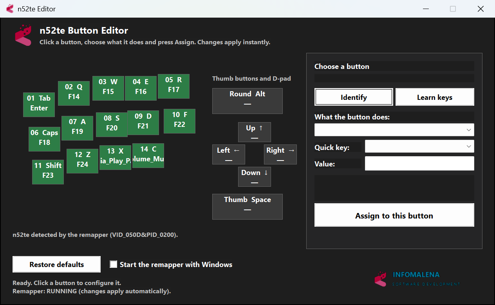
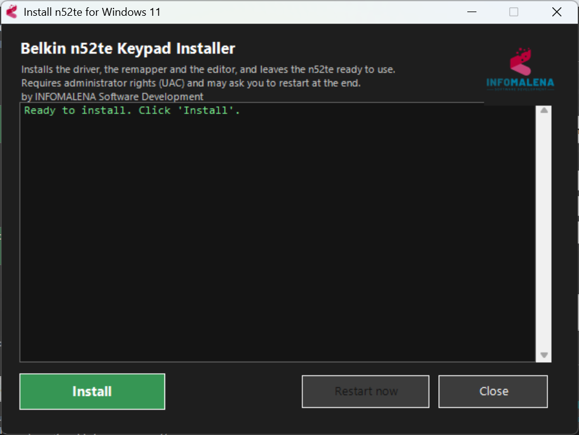

# n52te Windows 11 Driver — Belkin / Razer Nostromo n52te

**Make your Belkin n52te (a.k.a. Razer Nostromo n52te / n52 Tournament Edition) gaming keypad work perfectly on Windows 11 and Windows 10 (64-bit).** The original 2008 Belkin/Razer software no longer works on modern Windows — this project replaces it with a one-click installer, a per-device remapper (your normal keyboard is never touched) and a visual button editor.

<p align="center">
  
</p>

---

## ⬇️ Quick download

1. Go to the **[Releases](../../releases/latest)** tab and download **`Install-n52te.exe`**.
2. Run it (it will ask for administrator rights).
3. If Windows shows *"Windows protected your PC"* (SmartScreen): click **More info → Run anyway** (normal for free software without a paid code-signing certificate).
4. Follow the steps. Done!

<p align="center">
  
</p>

## 🔒 Verify your download is authentic

This installs a driver, so **only download it from this repository's [official Releases tab](../../releases/latest)** — never from third-party sites, which could ship a modified version with malware.

To make sure the `.exe` you downloaded is exactly ours, check its **SHA-256** fingerprint. Open PowerShell in your Downloads folder and run:

```powershell
Get-FileHash .\Install-n52te.exe -Algorithm SHA256
```

The result must match this **exactly** (also published in [`Install-n52te.exe.sha256`](Install-n52te.exe.sha256)):

```
8F46EFFC5D02CC49DF18BD90424FC2B37496F7115F7995BA66E5EA20277F678F
```

If it doesn't match, **don't run it**. You can also upload the file to [VirusTotal](https://www.virustotal.com/) and scan it yourself before running it.

## ❓ Why is this needed?

The **Belkin n52te** (and its twin, the **Razer Nostromo n52te**) is a legendary 2008 gaming keypad. The official Belkin/Razer software (`n52te v2.1.2`, July 2008) was built for Windows XP/Vista and **its driver no longer loads on Windows 11** — Core Isolation / Memory Integrity (HVCI) blocks kernel drivers that old — so the original profile editor shows *"n52te not connected"* and you can't reprogram the buttons.

**The device itself still works** as a keyboard on Windows 11 (it types whatever is stored in it), but you can't reconfigure it. This project fixes that with modern software.

## ✨ What's included

- **🎮 True per-device separation**: only the n52te's keys are remapped. Your normal keyboard keeps typing normally — no lag, no interference. (Built on the [Interception](https://github.com/oblitum/Interception) driver, compatible with Windows 11 Memory Integrity — **no need to disable any security feature**.)
- **🖱️ Visual editor**: the 14 buttons + thumb pad + D-pad + scroll-wheel click drawn with the device's real shape. Click a button, choose what it does, save — applied instantly.
- **⌨️ Each button can be**: a key (including F13–F24, which conflict with nothing), a combo/macro (`Ctrl+C`, `Alt+Tab`…), typed text, launching a program or website, or a keymap switch.
- **🎨 Blue / Red / Green keymaps**: like the original Belkin software, every button can do something different in each of three keymaps. Give any button the **Switch keymap** action: cycle through all three, or jump to one color (toggle, or only while held). The keypad's own lights can't change color without Belkin's old driver, so the active keymap is shown in the editor and in the remapper window's title instead.
- **🔍 Identify mode**: press a physical button and it gets selected on screen.
- **🎓 Learn keys**: if your keypad still has a custom profile stored on it (red/green/blue mode, or any non-default layout), press **Learn keys** and then each button once. The editor learns which key every button sends and recognizes your unit, even if it reports a different USB ID.
- **🚀 Optional start with Windows**, running in the background.
- **📦 One-click installer** that cleans up old Belkin driver leftovers, installs the driver and leaves everything working.

## 🕹️ Original Belkin n52 (non-TE) owners

Experimental: the remapper filters by Belkin's USB vendor ID (`VID_050D`), not only the n52te's product ID, so the **original Nostromo n52** (black/gray/orange) should be picked up too. If it types different keys from the default ones (Tab/QWE/ASD…), or the editor says the remapper doesn't recognize it, use **Learn keys** in the editor. If your unit still behaves differently, please [open an issue](../../issues) and paste the text of the remapper window. Feedback welcome.

## 🆘 "I remapped a button but it still types the old key"

1. **Test outside the editor**: while the editor window is focused, the n52te types raw on purpose. Click another window (e.g. Notepad) first.
2. Look at the line under the keypad drawing. If it says the remapper **does not recognize** your n52te, press **Learn keys** and press each button when asked. This also covers keypads that still carry an old onboard profile (red/green/blue modes).

## 🚧 Known limitations

- **Keypad lights and onboard memory**: the n52te stores a profile in its own memory, including which keymap it starts in (and so its light color). Only Belkin's original driver can change that memory, using an unpublished protocol. So the light shows the keypad's stored keymap, not this app's Blue/Red/Green keymap: use the editor ("Remapper keymap") or the remapper window title to see that one. If the original software left some controls unassigned in the stored profile (for example a D-pad direction or the wheel), they send nothing until the profile is reset with the original Belkin software.
- **Scrolling the wheel** isn't remappable: it works as a normal mouse wheel. Its click is remappable.
- **Buttons that send nothing**: if a control (for example a D-pad direction) doesn't react in Identify or Learn keys, the keypad isn't sending anything Windows can see, so no software can remap it. On one test unit the D-pad Left and wheel scrolling were silent at the USB HID level — try the keypad on another PC to rule out a hardware fault.

## 🧩 Compatibility

| | |
|---|---|
| **Device** | Belkin n52te · Razer Nostromo n52te · n52 Tournament Edition (`VID_050D&PID_0200`) · original Belkin n52 (experimental) |
| **OS** | Windows 11 and Windows 10 (64-bit) |
| **Requirements** | Administrator rights to install the driver |
| **UI language** | English (US) |

## 🛠️ How it works (technical)

- The n52te enumerates as a standard HID keyboard. To remap **only** its keys without touching your physical keyboard, input must be filtered at driver level: this project uses the **Interception** kernel driver (signed, HVCI-compatible).
- A small background service (`n52te_interception.exe`) reads every keystroke, checks whether it comes from the n52te (`VID_050D`) and, if so, emits the configured action; any other keyboard passes through untouched.
- The scroll-wheel click arrives from the n52te's separate mouse interface. The remapper filters only that interface, and only its middle-button events, so your own mouse and all mouse movement are never captured.
- The editor (`n52te Editor.exe`) writes the configuration to `%ProgramData%\n52te\n52te_config.ini`, which the remapper hot-reloads automatically (~1 second). The Blue keymap is the `[Botones]` section, Red and Green are `[Botones.Red]` and `[Botones.Green]`; a keymap switch is stored as `keymap|cycle`, `keymap|red` or `keymap|red hold`. Configs from earlier (Spanish) versions keep working unchanged and load as the Blue keymap.
- The remapper writes the active keymap to `%ProgramData%\n52te\keymap.txt`, which the editor displays.
- Deploying to several workstations: install once per machine (admin + one restart) and copy the same `.ini` everywhere. No cloud, no accounts, no Synapse.

Detailed install guide: **[INSTALL.md](INSTALL.md)**.

## 🔧 Building from source

The source for the editor (AutoHotkey v2), the remapper and the installer (C#, .NET Framework 4) is in [`src/`](src). It was recovered from the upstream v1.1.0 installer and translated to English. To build `Install-n52te.exe`:

1. Put **AutoHotkey 2.0.30** in `tools\ahk\` and **Ahk2Exe** in `tools\ahk\Compiler\` (see the header of [`build.ps1`](build.ps1) for download links).
2. Run `powershell -ExecutionPolicy Bypass -File .\build.ps1`. The installer and its `.sha256` are written to `build\`.

The C# compiler that ships with Windows is used, so no Visual Studio is needed.

## 🙏 Credits and third-party licenses

- **[Interception](https://github.com/oblitum/Interception)** by Francisco Lopes (oblitum) — input capture driver (free for non-commercial use).
- **[AutoHotkey v2](https://www.autohotkey.com/)** — the editor is built with AutoHotkey.
- Original driver and device: **Belkin International** / **Razer**.

This project is distributed **free of charge** (see [LICENSE](LICENSE)). Always verify your download against the SHA-256 above.

## ⚠️ Disclaimer

**Unofficial** project, **not affiliated** with Belkin or Razer. "n52te", "Nostromo", "Belkin" and "Razer" are trademarks of their respective owners, used descriptively only. Software provided *as is*, with no warranty. Installing drivers is at your own risk.

---

<p align="center">
  <br>
  <sub>Made by <b>INFOMALENA</b> · Software Development · <a href="https://www.infomalena.com">infomalena.com</a></sub>
</p>
